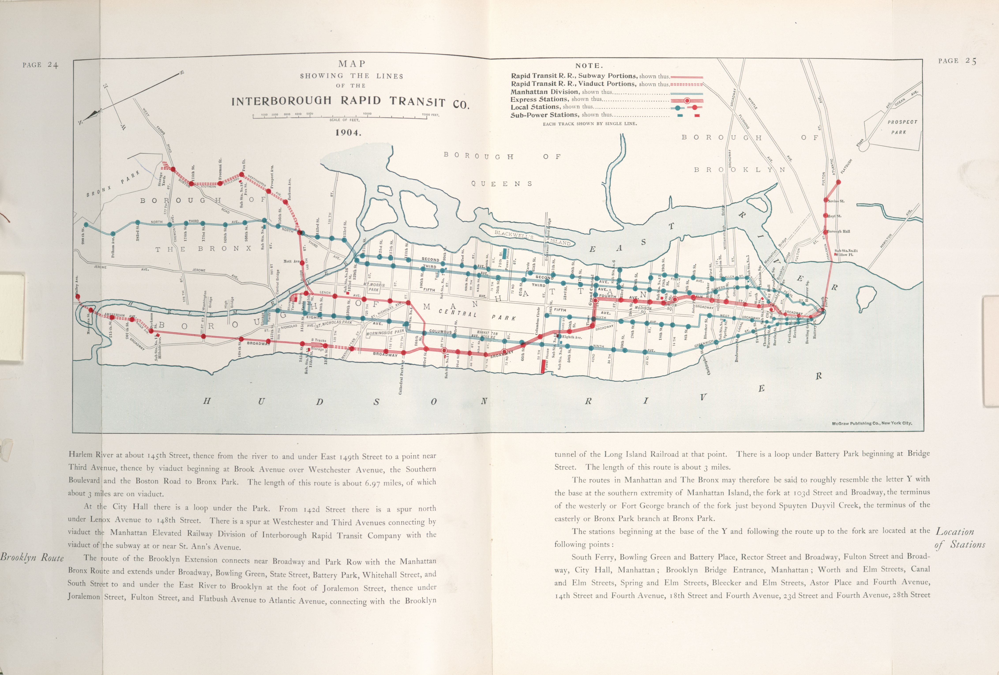
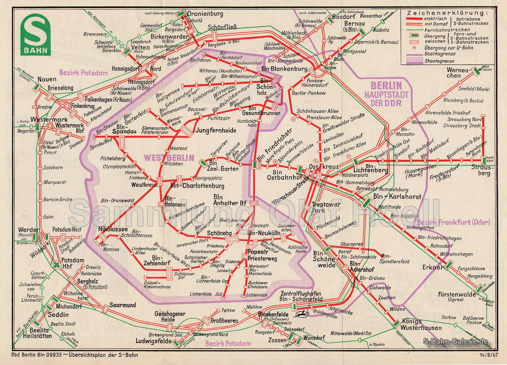
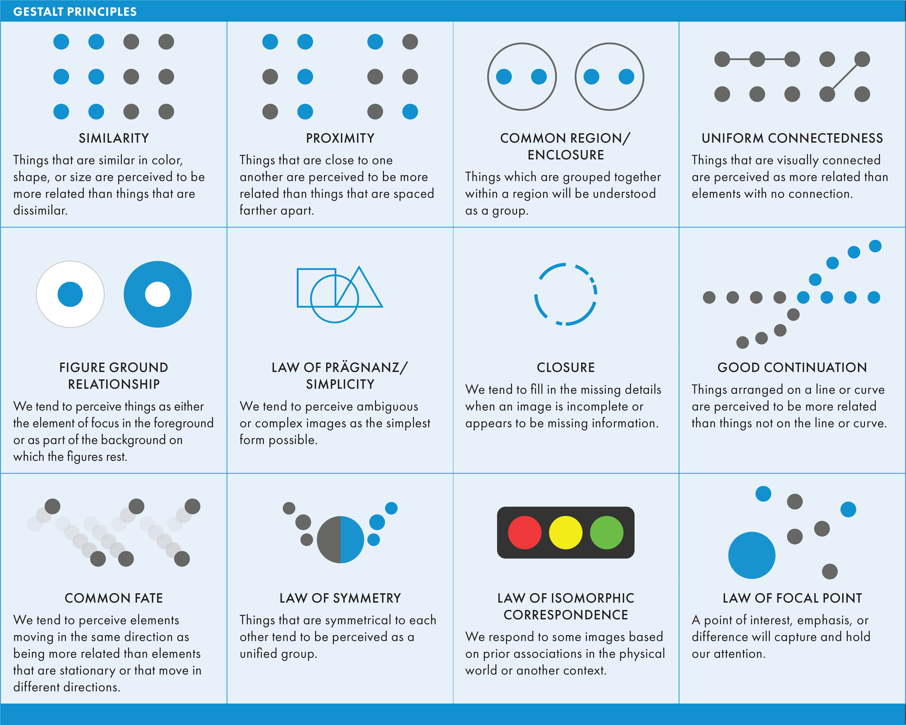
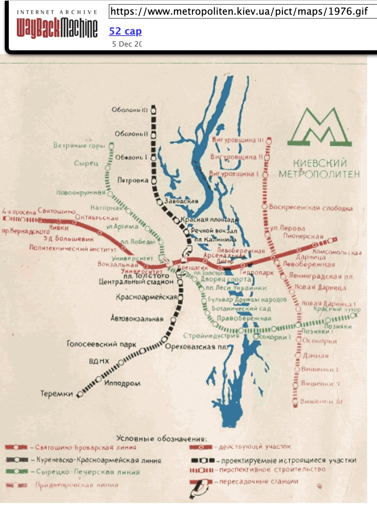
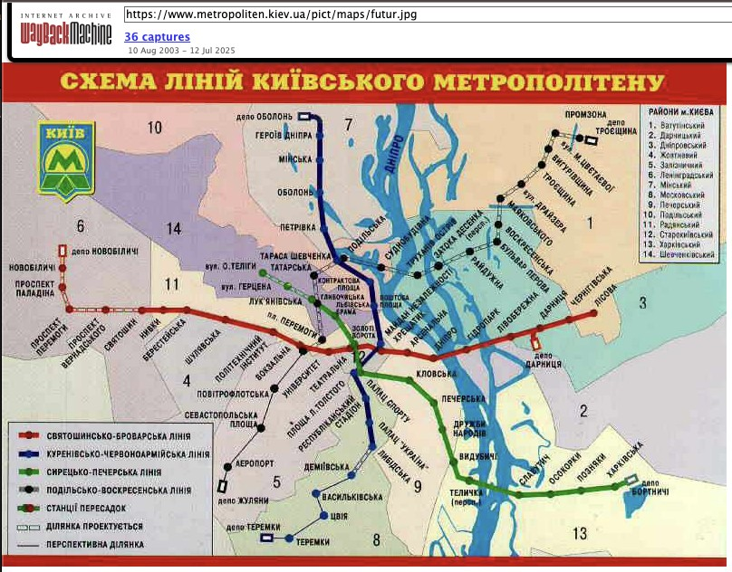
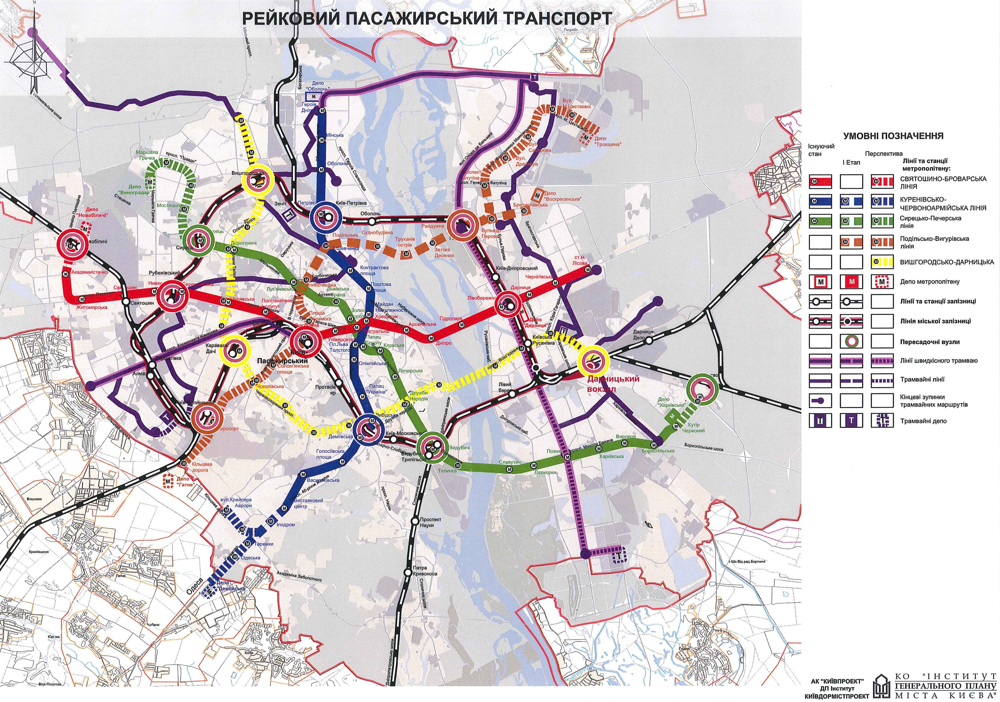
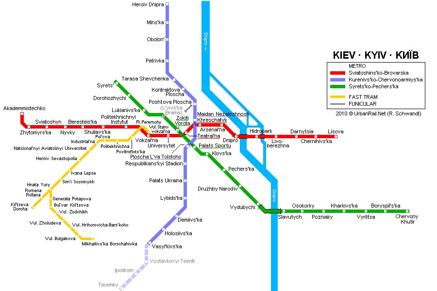

<!-- Check British/US english visualisation/visualization -->

# Historical metro maps as data visualisations

[Introduction](#introduction)

[1 From real world phenomena to data visualization](#1-from-real-world-phenomena-to-data-visualization)

[2 Does data really speak for itself?](#2-does-data-really-speak-for-itself?)

[3 Metro maps as data visualisations and historical sources in context](#3-metro-maps-as-data-visualisations-and-historical-sources-in-context)

## Introduction

This lesson offers an introduction to the critical analysis of metro maps both as historical sources and as data visualisations, using the case study of Kyev’s metro. What you learn in this lesson can be applied to other types of data visualisations, as well as to metro maps of other cities and historical periods.

Data visualisation is the process of representing data visually to support understanding, exploration, and communication. It is important to understand that there are many ways to visualise data where complexity is central to both the representation and the exploration of the data. However, in this lesson we are going to focus on data visualisation with the aim of extracting information as quickly as possible; in the case of the metro, this involves exploring a network graph.

The critical analysis of a data visualisation shares most of the key questions frequently asked about digitised and born digital sources. However, further consideration is required to assess for example the level of abstraction, the impact on cognition and, as we will see in our case study, certain additional questions specific to metro maps (e.g., perceived geography).

In this lesson, you will learn that:
1. **Metro maps as data visualisations** are the result of a transformation pipeline from real world phenonema such as geography or distances, captured as data into nodes and edges, and finally represented as a network graph visualisation.
2. **Data does not speak for itself and neither does its visualisation**. There are economic, cultural, political, social and historical narratives that metro maps can tell.
3. **Contextualisation is a fundamental practice in data analysis and visualisation**, as well as in the interpretation of historical sources. For that purpose, we will explore how to combine and compare metro maps for a deeper analysis.

Each section includes practical exercises designed to develop your critical thinking, as well as additional resources where you can explore the content further if required.

## 1 From real world phenomena to data visualization

[!NOTE]
*Learning objectives:*
By completing this section, you will be able to:
- Understand the different levels of abstraction from data collection to representation and how these apply to metro maps

Does data objectively capture the phenomena taking place in the real world? Drucker says that “by recognizing the always interpreted character of data we have shifted from data to capta, acknowledging the constructed-ness of the categories according to the uses and expectations for which they are put in service” (Drucker, 2011). Loukissas explains that “in thinking about when something becomes data, we must lend weight to the material processes involved; measuring, recording, and otherwise capturing the world are processess with physical constraints. (...) Aspects of the original subject are inevitably lost in translation” (Loukissas, 2019).

In other words, it is important to pay attention to how data constructs a representation of the reality, shaped by the choices, interpretations, purposes and material limitations involved in its collection, inevitably leaving out certain aspects of the original phenomenon.

A data visualisation is a representation of information that involves transforming real-world phenomena into a simplified visual form through a process of abstraction. This process usually includes four steps: 
1. A real-world event, system, or situation is observed. 
2. Data collection: information about the phenomenon is gathered through observation, measurement, surveys, records, or technology. 
3. Representation: the data is converted into a visual form
4. The representation is perceived by the human perceptual and cognitive system.

There is a “widespread belief that large data sets offer a higher form of intelligence and knowledge that can generate insights that were previously impossible, with the aura of truth, objectivity, and accuracy” (Boyd *et al.*, 2012). As D'Ignazio (2019) further observes, “data visualization is often the visual enactment of this “aura of truth”, arguing that “learning to be a critical reader and designer entails learning productive ways to challenge that aura”. This is therefore the focus of this first section.

### 1.a From phenomena to data

What exactly does this mean? Look at the metro maps provided in figures 1 and 2. Then answer to the following questions: 

1. What sort of real-world events lie behind the data needed to create this map? Could you name at least five? 
2. How are they collected as data? What sort of decisions do you think might have been made between observing these phenomena and recording them as data? Make a list of five key questions.

Figure 1. Map showing the lines of the Interborough Rapid Transit Company. New York, 1904. [The New York Public Library Digital Collections](https://digitalcollections.nypl.org/items/6f180ec0-c6d1-012f-63dc-58d385a7bc34?canvasIndex=0). Public domain. 

Figure 2. Berlin S-Bahn. Network Map, 1967 (Netzplan der S-Bahn Berlin - 1967). Source: *S-Bahn-Galerie.de.* [URL](https://www.s-bahn-galerie.de/S_Bahn_Berlin/xPlan_Bln/Plan_S_B_1961-1980/1967_S-Bahn-Berlin.htm). (*Add information on rights of use*) 

  
Do you need help?

Some examples would include geographic phenomena such as distances between stations, elevation changes, administrative boundaries, rivers and waterways; mobility phenomena such as passenger movements, peak-hour demand, origin-destination flows, accessibility needs; socio-economic phenomena such as population density, employment density, urban growth, tourist activity; environmental phenomena such as noise levels or weather changes, among many others. These provide the basis for planning and designing metro lines, informing the decisions that shape the physical network and, ultimately, its representation in metro maps.

Different phenomena are captured into data using different methods. For example, distances, elevation changes or noise levels would be measured, accessibility needs could be collected using a survey, and touristic activity could be recorded through observation (among other options).

The sort of decisions made during the data collection process are reflected in the decisions about what gets measured, why it gets measured and how it gets measured. For example who is the metro system and the metro map designed for (i.e., who is the target population: workers, tourists,...)? Why a data collection method is selected and what are the limitations (i.e.,how was the sample selected)? What tools, instruments, or technologies were used to collect the data? When was the data collected? Who was responsible for the data collection?. These are just some examples of decisions that would alter the result significantly. Would it be the same to collect data for a metro system aimed at commuters travelling from the suburbs to the office districts as it would be to cater for the large numbers of tourists visiting the historic districts? It is important to understand that a critical view of the data collection process is important to challenge any “aura of truth”. Additionally, as historians, the answers to all these questions bring relevant historical information as we will see in the next sections.

Real-world phenomena are rarely isolated; they exist within complex systems of relationships and interdependencies. These relationships can be understood through the concept of a network, composed of interconnected entities (nodes) and the connections between them (links).

In figures 1 and 2, what do the nodes and the connections between them represent respectively?

  
Need help? Click to expand

The nodes are the stations and the links are the urban transportation lines.

### 1.b From data to representation - preattentive processing

Once the data has been collected, the next part of the transformation comes into place, its visualisation. In order to critically approach a representation, we first need to understand how attention is captured and how we organise and interpret what we see. For that purpose, we are introducing in this and the following section two relevant concepts in data visualisation: preattentive attributes and Gestalt principles.

Look at the two images below, how many fives can you count on the first image? What about the second? Can you see the difference? This is an example of how we can leverage color as a preattentive attribute in data visualisation.

Figure 3. Colour as a preattentive attribute. Image generated with use of generative artificial intelligence (Copilot). 

Preattentive attributes are visual features that the human brain notices almost instantly. There are other preattentive attributes we can use apart from color. Read this short article on pre-attentive attributes: 

Wink, Isaac. *Research Guides: Data Applications Services: Tips for Creating Effective Data Visualizations*. [URL](https://libguides.uky.edu/data_applications/data_viz_tips).

Why is this important? In data visualisation, certain things are shown “at a glance”. For example in the case of metro maps, if you want people to instantly identify a certain information, it should be differenciated from all other information in a preattentive way.

Now, use what you read on preattentive attributes to do the following exercise. 

Look at the [New York Subway map](https://www.mta.info/map/5256) or the maps on figures 1 and 2. 

* What do you notice instantly (i.e., pre-attentively: color hue, intensity, orientation, shapes)?
* Which visual elements are highlighted?
* Which ones are downplayed?
* How do preattentive attributes affect the perception of centrality?
* What do you observe about the shape of the lines?
* Can you find other metro maps where it is not like that?<!-- Masha: This is a potential place to introduce the history of metro maps -->
* Which stations stand out?
* Which lines dominate visually?
  

  
Do you need help?

  <!-- Masha: Do a visual analysis of a metro map of your collection. I add some ideas below, or we can just leave it as it is more general. -->

Examples in metro maps typically include:
- Color: Different lines use distinct colors so passengers can immediately distinguish routes.
- Shape: Symbols such as circles identify stations or transfer points.
- Size: Larger symbols or text may highlight major stations or hubs.
- Position: The placement of stations and lines helps users recognize connections and direction.
- Orientation: Straight horizontal, vertical, or diagonal lines make routes easier to follow visually.

Do you think that all the preattentive attributes are equally strong?

  
Do you need help?

There are degrees of popout, but in general, the strongest effects are based on color, orientation, size and contrast.

<!-- Add an example image, it can be a generic one or if we find an example especifically for metro maps -->

### 1.c From data to representation - Gestalt laws

"The visual brain is a powerful pattern-finding engine. There is no other way of presenting information so that structures, groups, and trends can be discovered." (Ware 2019). 

In this subsection we will discuss: what does it take for us to see a group and what does constitute a visual connection between objects?

The Gestalt principles of pattern perception are a set of rules that describe the way we see patterns in visual displays, and these translate into a set of design principles for data visualization. 

Figure 4. Gestalt principles. [FIO101](https://www.flickr.com/photos/rosenfeldmedia/49932103068) [Rosenfeld Media](https://www.flickr.com/photos/rosenfeldmedia/), [CC BY 2.0](https://creativecommons.org/licenses/by/2.0/deed.fr)

We focus on six of the Gestalt principles:

1. Proximity: Objects that are close together as perceived as a group
2. Similarity: Objects with similar attributes (i.e., color, shape) are perceived as a
group
3. Enclosure: Objects surrounded by a common boundary (i.e., a line, a colored
area) are perceived as a group.
4. Closure: The mind tends to fill in missing visual information to perceive
incomplete shapes or patterns as complete.
5. Continuity: The eye naturally follows smooth, continuous lines and paths
rather than abrupt changes or interruptions.
6. Connection: Elements linked by connectors (i.e., a line) are perceived as
belonging together. 

Do the following exercise. 

How do Gestalt principles apply to the maps of figures 1 and 2? 

Alternative metromaps for the exercise: Tokyo Subway Route [map](https://www.tokyometro.jp/lang_en/station/202303_number_en.pdf).

- How does the principle of similarity apply: are all the stations represented consistently? Are similar symbols used for differet purposes? Do line colors clearly communicate membership to a specific route?
- What about the principle of proximity: are transfer stations close enough to suggest connectivity? Does spacing help users identify routes?
- Can you maybe observe any features that comply with the principle of Continutiy? (e.g., facility to follow a line without interruption, confusing crosses, line bends to support visual flow,...)

<!-- Masha, this is an alternative place to introduce the history of metro maps as they also evolved based on these principles. -->

As you now understand, there are many decisions behind the data collection and visualisation process, starting from what is counted, to how it's organised and categorised and finally represented. Data visualisation is leveraged to reduce cognitive load so that the user can focus on a specific objective, as in the case of metro maps. However, as we have seen, this also implies [abstraction and omission of information](https://ranke2.uni.lu/u/digital-maps/#assignment-02-reading-maps.en), that we need to be aware of when exploring metro maps as historical sources. 

In the next section we will analyse the specific implications on how metro maps as data visualisations communicate certain historical and political narratives, that require a critical analysis of what is there and how it is represented, and what has been omitted and the potential reasons behind.

### Reading/viewing suggestions  

Drucker, Johanna. “Humanities Approaches to Graphical Display.” *Digital Humanities Quarterly* 5 (1), 2011. https://doi.org/10.63744/r4ysrh7ae534.

Loukissas, Yanni Alexander. (2019). *All data are local: Thinking critically in a data-driven society*. The MIT Press

Boyd, danah, and Kate Crawford. CRITICAL QUESTIONS FOR BIG DATA: Provocations for a cultural, technological, and scholarly phenomenon. *Information, Communication & Society*, 15(5), June 2012. 662–679. [DOI](https://doi.org/10.1080/1369118X.2012.678878)

D’Ignazio, Catherine. Data Visualization. In Renee Hobbs and Paul Mihailidis (eds), *The International Encyclopedia of Media Literacy*, 1st edn. Wiley: 2019, 1–10.  [DOI](https://doi.org/10.1002/9781118978238.ieml0095)

Kuznetsova, Anastasiya. Gestalt Principles in Data Visualization. *Medium*, 24 November 2023, [URL](https://nastengraph.medium.com/gestalt-principles-in-data-visualization-a4e56e6074b5).

Ware, C. (2019). Information visualization: perception for design. Morgan Kaufmann.

Wink, Isaac. Research Guides: Data Applications Services: Tips for Creating Effective Data Visualizations. https://libguides.uky.edu/data_applications/data_viz_tips. Accessed 18 November 2026.

## 2 Does data really speak for itself?

[!NOTE]
*Learning objectives:*
By completing this section, you will be able to:
- Understand that data does not speak for itself, nor does its visualization and how a narrative can be controlled through visual saliency.
- How this applies specifically to metro maps and how to read implicit narratives.

Data does not speak for itself, nor does its visualizations. A metro map, for example, encodes economic, cultural, political, social, and historical narratives. Now that you understand how data can be visually encoded, you can examine how controlling saliency is used to emphasize certain narratives. This section focuses on developing an awareness of that visual emphasis in any representation.

### 2.a Controlling the saliency 

We will start this section with an exercise, exploring the following example: 
 [The New York Times' One Report Diverging Perspectives](https://archive.nytimes.com/www.nytimes.com/interactive/2012/10/05/business/economy/one-report-diverging-perspectives.html)

* How does the same report present diverging perspectives? Switch between "How a democrat might see things" and "How a republican might see things?"
* What visual elements change in the representation?
* How does the visualisation look like without any of those elements? Click on "September Jobs Report".
* How do you think would the readers decide what's the narrative?
* Can you make a list of the visual elements used to control the saliency?

  
Do you need help?

Some of the elements used to control the narrative in the example include:
<ul>
  <li>Modifying the x-axis to present partial data.</li>
  <li>Using color to highlight specific values or a range of values.</li>
  <li>Adding reference lines as a baseline for comparison, to measure success or failure.</li>
 <li>The use of titles, subtitles, and explanatory text.</li>
 <li>The use of annotations to highlight important figures.</li>
</ul>

If we look at the visualization without any of these elements, the readers could be influenced by their expertise in the subject, their political opinions or their level or visual data literacy, among others.

“If grouping, highlighting, and annotation can guide viewers toward a certain comparison or pattern, then for better or worse, a visualization designer has some control over what their viewers see in a data set”. (Franconeri *et al.*, 2021)

To know more about the complexities of truth and deception in visualisation, please read the works of Cairo included in the reading suggestions section.

### 2.b Controlling saliency in metro maps

Now, we will focus on a metro map. 
Check the [Hong Kong metro map](https://www.mtr.com.hk/archive/en/services/routemap.pdf).

Try to answer the following questions, grounding your answers in the visual elements and how the saliency of the map is controlled:

* What kind of city does the metro map suggest: ordered, complex, dense, accesible, equal, hierarchical, modern, other?
* What routes are perceived as more used, more important, more efficient?
* Which aspects of the map have been highlighted or simplified and why could that be? What assumptions did the designers make about the passengers’ perspective and priorities? Whose mobility is prioritised?
* Is the map tourist-centric, commuter centric, etc. and why? What are the key stations? 
* Do the choices about language or naming conventions encode colonial, political and cultural legacies?
* What additional modes of transport are shown?
* How does the metro map encode power structures?

  
Do you need help?

  The legibility of a simplified layout can suggest an ordered and efficient city, while a high density of connections around central stations can reflect their strategic importance as major commercial or business districts. A schematic layout prioritises route legibility over geographical accuracy, aimed primarily at commuters who need to identify stations, follow routes and navigate transfers efficiently between residential areas and employment centres. In contrast, a geographically accurate representation prioritises spatial orientation and the relationship between the transport network and the wider urban environment, catering more broadly to passengers interested in understanding where stations are located in relation to neighbourhoods, landmarks and geographical barriers. The use of multiple languages can make the network accessible to international visitors while reflecting colonial legacies and local cultural identities through station names. Finally, the display of connections to wider regional transport infrastructure can communicate political priorities and the city's relationship with the surrounding region.

A deep understanding of the historical and cultural context would, of course, allow for a more nuanced analysis, as it would be the case when analysing metro maps as part of historical research. Consider the following citation: 
“Meaning is context-bound, and context is boundless” (Culler, 1998 cited in Loukissas 2019).

In section 3 we look at metro maps as historical sources in context.  

### Reading/viewing suggestions 

Franconeri, Steven L., *et al*. “The Science of Visual Data Communication: What Works”. *Psychological Science in the Public Interest* 22 (3), December 2021: 110‑61. [DOI](https://doi.org/10.1177/15291006211051956).

Cairo, Alberto. *The truthful art: Data, charts, and maps for communication*. New Riders, 2016

Cairo, Alberto. *How charts lie: Getting smarter about visual information*. W.W. Norton, 2019

## 3 Metro maps as data visualisations and historical sources in context  

Contextualisation is a key practice both in critical analysis of data visualisation and historical sources. How do we look at metro maps in combination with other maps? What new perspectives does it offer to look at the multiple versions of the same metro maps (e.g., official one vs. construction map), the official map over time, or in combination with other maps (e.g, Olympics, Internet coverage)? What contradictions do we find, and what information appears and disappears among them or over time?

[!NOTE]
*Learning objective:*
By completing this section, you will be able to:
- Trace the process of transformation from real-life phenomena into an structural network across multiple cities.
- Contextualise the implicit narrative of a metro map within a historical setting by comparing it with other spatial and network visualisations.

In this section, we examine the historical and urban context behind the development of schematic network maps that replaced geographically accurate representations in London, Paris, and Kyiv.

### 3.a From geographical map to structural network

The London Underground was the world's first metro system, entering service in 1863 under the name Metropolitan Railway. Not only did the metro as a mode of urban transportation originate in London, but the city also gave rise to the first schematic, non-geographical metro map. This innovative design remains the model that continues to shape how we think about and represent metro networks today.

Take a look at the following video: TED: The genius of the London Tube Map. Michael Bierut on "Small Thing Big Idea". [YouTube video](https://www.youtube.com/watch?v=Aw_1mOwx5gM&t=5s)

Answer the following questions: 
* What was the innovation of Harry Beck? 
* What was his main argument regarding the passengers' needs? 
* How did Beck redraw the underground? What techniques did he use?

You can also check [the 1933 London underground map](https://www.ltmuseum.co.uk/collections/collections-online/maps/item/1999-321).  

  
Do you need help?

The development of metro maps is often associated with Harry Beck, a draftsman in the London Underground Signals Office, who designed a new map in 1933 that was in fact more of a diagram than a conventional map. His design prioritized passengers' needs rather than geographical accuracy. Beck argued that travellers were not concerned with what lay on the surface; they simply needed to know how to get from one station to another. As he famously put it, “It is the system that is important, not the geography.” Geographically accurate maps often made the network appear more confusing than it was. Beck therefore removed all above-ground references except the River Thames and redrew the network using colour-coded lines and evenly spaced stations arranged along horizontal, vertical, and 45-degree angles.

Now: 
* Read the following article: Mark Ovenden. “Harry Beck: The Paris Connection”. *Creative Review*. March 2009. [URL](https://www.tubemapcentral.com/showcase/mediafiles/CreativeReview_March2009.pdf/) OR “Harry Beck: the Paris connection” https://ateliertally.com/harry-beck-the-paris-connection/ 
* Check this [1939 map of the Paris métro](https://fr.wikipedia.org/wiki/Plan_du_m%C3%A9tro_de_Paris#/media/Fichier:M%C3%A9tro_parisien_%C3%A9tat_du_r%C3%A9seau_en_1939.jpeg)  
* See [the collection of Paris metro maps from different decades](https://fr.wikipedia.org/wiki/Plan_du_m%C3%A9tro_de_Paris)

Answer the questions: 
* What were the reasons behind the rejection of Beck's map? Think what was the main difference of the Paris plans compared to Beck's. 
* What created difficulties for adapting diagrammatic approach in Paris? 
* How did the Paris metro schemas evolved over time? 
* How does this evolution reflect the perception of the city by Parisians? 
* How does visualisation reflect this perception?

  
Do you need help?

The neighbouring Paris Métro network, by contrast, was for many years represented almost exclusively through geographically accurate maps. Although Beck was invited to develop a schematic map for the Paris Métro and produced two versions after the Second World War, both proposals were rejected, and the well-known “spaghetti” style of representation remained in use. It was only in 1987 that the Paris Métro map began to move away from a strictly geographical representation towards a schematic diagram, following the international conventions of metro mapping. In the early 2000s, it further adopted several of Beck’s design principles.

Finally, explore how the creation of transport diagrams across national contexts has led to the emergence of a universal visual language. 

* Look at the Kyiv Rapid Transit Map introduced in 2015 that used Beck’s 1935 diagram as a model and source of inspiration. Can you read and understand this metro map despite language barriers and limited knowledge of the local geography?  

<!-- Its designers, Ahenty Zmin, examined official metro maps from around the world dating from 1908 to 2014 and identified a broader transition from geographically accurate maps to schematic diagrams. As they observed, “Diagrams allow information about the transport network to be laid out more evenly and enable passengers to find the information they need quickly and accurately whilst on a fast-moving metro carriage. When designing such diagrams, one must take into account, at the very least, poor lighting, swaying whilst the train is in motion, and overcrowding in the carriages.”-->
 

Figure . Official Kyiv Rapid Transit Map. 2026. [Source](https://a3.kyiv.ua/projects/metromap/). Courtesy from [website](https://a3.kyiv.ua/) for free non-commercial use.  

* Explore two projects that represent two completely different ways to visualize subway maps from around the world. See how the ideas we have explored in this section apply
to many more examples. 
  * [RailsMaps](https://railsmaps.com/world/metro)
  * [World Metro Map](https://www.worldmetromap.com/map) 

Considering the above, reflect on the power of standardized diagrammatic forms, particularly network graphs, which assume and reinforce a common visual literacy among their users. 

### 3.b Reading critically metro maps in levels

Why and how metro maps should be read critically?
In the following section, we present several examples of metro schemas employed as versatile visual tools to tell stories and represent phenomena that extend beyond their conventional function of helping passengers navigate a rapid transit system.

Are metro maps merely representations of transport systems, or do they constitute a broader diagrammatic language capable of depicting different realities?

We can distinguish three levels of lecture: 

* First level: an official “real” map of everything passengers can see and use.
* Second level: a functional map including realities that the passengers do not see (stations under construction, ghost stations out of use, service tunnels...) This kind of map is a reality for those managing and working in the metro network.
* Third level: maps depicting future plans for the development of the network, mixing both existing and envisioned networks. This third level of reality is the most fragile: some plans come to life, thus moving to the first level of reality (ordinary passenger maps), others are abandoned for different reasons and remain but a ghost of past dreams and hopes for the future.

Perceiving metro schemas with regard to these three layers of reality in a way allows to time-travel and see both past in the future and the future in the past. 

We explored the first level in subsection 3.a to see how diagrams help establish a visual *lingua franca*. Let's see how the other two levels make it necessary to be familiar with more specific temporalities and localised realities. 

Look at the following metro schemas from 1976, 2003 and 2017. Compare them with the Official Kyiv Rapid Transit System map of 2026 to see the state of plans' implementation.
  - How did the metro lines evolve? 
  - Which plans came to be? 
  - Which have not been realised?  
  - Think of possible reasons for the plans to have been abandoned.

Figure . M.Barashkow, Kyiv Metro, 1976. [Source](https://www.metropoliten.kiev.ua/pict/maps/1976.gif)

<!--alternatively, to avoid risk of using the image: Check the [Kyiv Metro schema from 1976, created by M.Barashkow](https://www.metropoliten.kiev.ua/pict/maps/1976.gif). --> 

Kyiv Metro Map, 2003. [Source](https://www.metropoliten.kiev.ua/pict/maps/futur.jpg)

<!--
alternatively, to avoid risk of using the image: Check the [Kyiv Metro Map, 2003](https://www.metropoliten.kiev.ua/pict/maps/futur.jpg). --> 

Kyiv Metro Map, 2017. Created by the municipal organisation "Institute of the General Plan of Kyiv City". [Source](https://www.unian.net/kyiv/2039651-v-kieve-budet-pyat-vetok-metro-opublikovana-karta-proekta.html) <!--OR http://kyiv.me/general-plan-of-kyiv-city/10-transport-and-street-network/-->

 

<!--
Not only the networks captures the evolution. An example of the changes of the country's policy was renaming of  Since 1990 15 stations (out of 52) in the Kyiv Metropolitan have been officially renamed (1 under-construction station was renamed before opening). These name changes occurred in a few waves:

First in direct aftermath of the fall of the Soviet Union and Ukraine gaining independence (early 1990s), then, during the post-Euromaidan decommunization. The names of soviet leaders and ideals were replaces with original toponyms, signalling the change of political orientation, moving away from the communist past.

Lastly, during the de-Russification following the 2022 full-scale invasion. As an example 'Druzhby Narodiv' ('Friendship of Nations') station (implying Ukrainian-Russian friendship) was renamed into  'Zvirynetska' - local toponym that originates from middle age Kyivan Rus, centuries before Principality of Moscow appeared on the map.
-->

### 3.c Metro maps in historical context 

Focus on the renaming of metro stations. 
Look at the following map of the Kyiv rapid transit system from 2010. 

 

Figure . Kyiv Rapid Transit Map, 2010. By UrbanRail.Net Source: OrangeSmile.com.<!--we need to find a good source and rights of use; cannot be used in this state-->

<!--alternative maps
* here? https://transphoto.org/articles/764/?st=30&lang=en
* this one https://commons.wikimedia.org/wiki/Category:Kyiv_Metro_maps#/media/File:Kiev_metro_route_map_uk_en.svg
* here: https://kyivpastfuture.com.ua/skhemy-kyivskoho-metropolitenu/ from 2011 or 2008? 

-->
Compare this map with the Official Kyiv Rapid Transit System map of 2026. 
* Can you find renamings of stations?
* Can you identify events in the history of Ukraine that led to renaming stations of the Kyiv Metro? Try to find at least three.
* Evoke at least one example of renaming in link with one of the events you identified.  

TIP: You can get help from the [Wikipedia article on the Kyiv metro](https://en.wikipedia.org/wiki/Ploshcha_Ukrainskykh_Heroiv_(Kyiv_Metro)). Eventually, you can do some research on the web on the topic in the language you prefer. 

* Around 2012, the Kyiv metro maps became by default bilingual using both the Ukrainian and the English languages. Make some research in the web and write a short text (300-500 words) outlining the context of this change. 
  
### 3.d Reflecting networks on networks

In October 2020, the Ministry of Digital Transformation of Ukraine posted on [its Telegram channel](https://t.me/mintsyfra) a plan of the Kyiv Metro showing the 4G internet coverage on the stations. This map uses the public transportation network to add a layer but about the progress of the Ministry in equipping metro stations with high-quality internet connection. 

Plan available on the website of the Transformation Office of Ukrain. [Kyiv Metro Map featuring 4G internet coverage](https://media.transformation.org.ua/wp-content/uploads/2021/03/01141822/metro-4dzh.jpeg). 
<!--[Facebook post of the Ministry](https://www.facebook.com/diia.gov.ua/posts/4g-%D0%BF%D1%80%D0%B0%D1%86%D1%8E%D1%94-%D0%BD%D0%B0-45-%D1%81%D1%82%D0%B0%D0%BD%D1%86%D1%96%D1%8F%D1%85-%D0%BC%D0%B5%D1%82%D1%80%D0%BE-%D1%83-%D0%BA%D0%B8%D1%94%D0%B2%D1%96%D1%82%D0%B5%D0%BF%D0%B5%D1%80-%D0%B2%D0%B8-%D0%B1%D1%83%D0%B4%D0%B5%D1%82%D0%B5-%D0%BD%D0%B0-%D0%B7%D0%B2%D1%8F%D0%B7%D0%BA%D1%83-%D1%83-%D0%BC%D0%B5%D1%81%D0%B5%D0%BD%D0%B4%D0%B6%D0%B5%D1%80%D0%B0%D1%85-%D0%B7%D0%B0/403313277739695/)-->

* How does this map correspond to the needs of passengers? Is the primary purpose to help nvigation in the city? In what way? 
* What could be the broder agenda (political, social) behind the depiction of the 4G system covering the Kyiv metro?
* How is the main message represented and highlighted visually? 
* What information is left in the background and how?

Can you think other examples of maps on maps?  

<!--
Another example would be how maps and schemas reflect big sport events. The Kyiv map from 1980 was meant for tourists who visited the city during the '80 Olympics and incorporated big sport location of the city as well as metro stations. Although Kyiv did not host the Games the importance of this event spread through the whole post-soviet space. 

Kyiv tourist map from 1980. From the private collection of M.Meleshko-Sudina.

We know from other sources that Kyiv metro was impacted by '80 Olympics. In control operator' journal - one of the exhibits from Kyiv metro museum, there is a records schedule changes for the metro trains to adjusted to the Games' schedule.

'During the days of the '80 Olympics, from July 21 to July 27, 1980, metro operated daily on weekdays with an extra insertion [service slot] for Olympic football at 30 pairs [of trains] per hour. On weekends, they operated on the Olympic schedule of 30 pairs per hour with an insertion for football [raising it to] 33 pairs per hour.' [translated with AI]

Another sport event that has impacted Kyiv Metro schemas was UEFA Euro 2012. Kyiv being one of the host cities welcomed hundreds of thousands football fans from all over the world and on this occasion metro has introduced bilingual metro schemas (Ukr + Eng). From this time on the announcement in metro trains is also done in both languages
-->

### Reading/viewing suggestions 

The genius of the London Tube Map. TED Series. 2 November 2018. YouTube video. [https://youtu.be/iBErp8qvWZg](https://youtu.be/iBErp8qvWZg)

Ovenden, Mark. “Harry Beck: The Paris Connection”. *Creative Review*. March 2009. (Available at [URL](https://www.tubemapcentral.com/showcase/mediafiles/CreativeReview_March2009.pdf/) 
[Archived version](https://web.archive.org/web/20220802212341/https://www.tubemapcentral.com/showcase/mediafiles/CreativeReview_March2009.pdf)

“Evolution of the Paris Metro Map: From Spaghetti Dish to Futuristic City”. Graphéine Branding, Brand Strategy and Brand Design. *Https://Grapheine.Com/*. 30 March 2017. https://grapheine.com/en/magazine/evolution-of-the-paris-Metro-map/.

Агенти Змін. *Схема Швидкісного Транспорту*. *https://a3.kyiv.ua/*. [URL](http://a3.kyiv.ua/projects/metromap). Accessed 19 November 2026. *(The author is the creator of the Kyiv rapid transit map).*

Monmonier, Mark S. *How to lie with maps*. Third edition, The University of Chicago Press, 2018.

