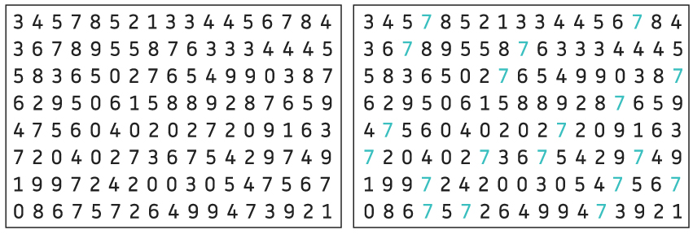
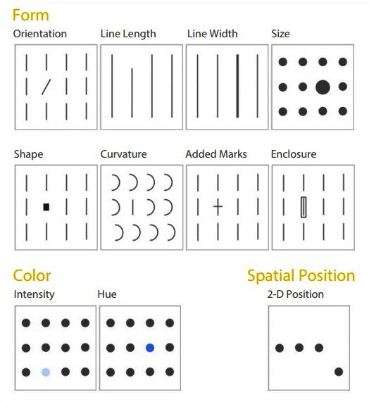
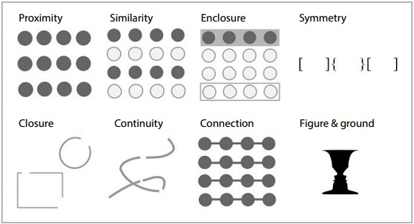

<!-- Check British/US english visualisation/visualization -->

# Historical metro maps as data visualisations

[Introduction](#introduction)

[1 From real world phenomena to data visualization](#1-from-real-world-phenomena-to-data-visualization)

[2 Does data really speak for itself?](#2-does-data-really-speak-for-itself?)

[3 Metro maps as data visualisations and historical sources in context](#3-metro-maps-as-data-visualisations-and-historical-sources-in-context)

## Introduction

This lesson offers an introduction to the critical analysis of metro maps both as historical sources and as data visualisations, using the case study of Kyev’s metro. What you learn in this lesson can be applied to other types of data visualisations, as well as to metro maps of other cities and historical periods.

Data visualisation is the process of representing data visually to support understanding, exploration, and communication. It is important to understand that there are many ways to visualise data where complexity is central to both the representation and the exploration of the data. However, in this lesson we are going to focus on data visualisation with the aim of extracting information as quickly as possible; in the case of the metro, this involves a network graph.

The critical analysis of a data visualisation shares most of the key questions frequently asked about digitised and born digital sources. However, further consideration is required to assess for example the level of abstraction, the impact on cognition and, as we will see in our case study, certain additional questions specific to metro maps (e.g., perceived geography).

In this lesson, you will learn that:
1. **Metro maps as data visualisations** are the result of a transformation pipeline from real world phenonema such as geography or distances, captured as data into nodes and edges, and finally represented as a network graph visualisation.
2. **Data does not speak for itself (and neither does its visualisation)**. There are economic, cultural, political, social and historical histories that metro maps can tell.
3. **Contextualisation is a fundamental practice in data analysis and visualisation**, as well as in the interpretation of historical sources. For that purpose, we will explore how to combine and compare metro maps for a deeper analysis.

Each section includes practical exercises designed to develop your critical thinking, as well as additional resources where you can explore the content further if required.

## 1 From real world phenomena to data visualization

[!NOTE]
*Learning objectives:*
By completing this section, you will be able to:
- Understand the different levels of abstraction from data collection to representation.
- To understand how this translates specfically to metro maps

Does data objectively capture the phenomena taking place in the real world? Drucker says that "by recognizing the always interpreted character of data we have shifted from data to capta, acknowledging the constructed-ness of the categories according to the uses and expectations for which they are put in service" (Drucker,2011). Loukissas explains that "in thinking about when something becomes data, we must lend weight to the material processes involved; measuring, recording, and otherwise capturing the world are processess with physical constraints. (...) Aspects of the original subject are inevitably lost in translation" (Loukissas, 2019).

A data visualisation is a representation of information that involves transforming real-world phenomena into a simplified visual form through a process of abstraction. This process usually includes four steps: 1)A real-world event, system, or situation is observed. 2)Data collection: Information about the phenomenon is gathered through observation, measurement, surveys, records, or technology. 3)Representation: The data is converted into a visual form, 4) The representation is pereceived by the human perceptual and cognitive system.

There is a "widespread belief that large data sets offer a higher form of intelligence and knowledge that can generate insights that were previously impossible, with the aura of truth, objectivity, and accuracy” (Boyd et al., 2012) and "data visualization is often the visual enactment of this "aura of truth". Learning to be a critical reader and designer entails learning productive ways to challenge that aura" (D'Ignazio, 2019). This is therefore the focus of this first section.

### 1.a From phenomena to data

What exactly does this mean? If we look, for example, at a metro map like the one in Image 1, what sort of real-world events lie behind the data needed to create this map? Could you name at least five? How are they collected as data? What sort of decisions do you think might have been made between observing these phenomena and recording them as data? Make a list of five key questions.

  
Do you need help?

  Some examples would include geographic phenomena such as distances between stations, elevation changes, administrative boundaries, rivers and waterways; mobility phenomena such as passenger movements, peak-hour demand, origin-destination flows, accessibility needs; socio-economic phenomena such as population density, employment density, urban growth, turist activity; environmental phenomena such as noise levels or weather changes, among many others. These are essentially all the observable events that exist before they are converted into data and then represented into a metro map.

Different phenomena are captured into data using different methods. For example, distances, elevation changes or noise levels would be measured, accessibility needs could be collected using a survey, and touristic activity could be recorded through observation (among other options).

The sort of decisions made during the data collection process are refleced in the decisions about what gets measured, why it gets measured and how it gets measured. For example who is the metro system and the metro map designed for (i.e., who is the target population: workers, turists,...)? Why a data collection method is selected and what are the limitations (i.e.,how was the sample selected)? What tools, instruments, or technologies were used to collect the data? When was the data collected? Who was responsible for the data collection?. These are just some examples of decisions that would alter the result significantly. Would it be the same to collect data for a metro system aimed at commuters travelling from the suburbs to the office districts as it would be to cater for the large numbers of tourists visiting the historic districts? It is important to understand that a critical view of the data collection process is important to challenge any "aura of truth". Additionally, as historians, the answers to all these questions bring relevant historical information as we will see in the next sections.

A network consists of:
- Vertices (nodes): the objects in the network.
- Edges (links): the connections between those objects.

  
Can you work out what this data relates to in the case of the underground map?

Exactly – the nodes are the stations and the links are the underground lines.

<!-- Additional references for network graphs? Expand explanations? Wait to see if the rest of the content is balanced. -->

MAP PROPOSAL SOFIA 1: S-Bahn, Berlin [https://www.s-bahn-galerie.de/S_Bahn_Berlin/xPlan_Bln/Plan_S_B_1961-1980.htm](https://www.s-bahn-galerie.de/S_Bahn_Berlin/xPlan_Bln/Plan_S_B_1961-1980.htm) *maps from 1964, 1967 seem interesting as they show both the network and the Berlin wall (as real world phenomenon)* 

MAP PROPOSAL SOFIA 2: A part of the NYC subway in 1904 [https://digitalcollections.nypl.org/items/6f180ec0-c6d1-012f-63dc-58d385a7bc34?canvasIndex=0](https://digitalcollections.nypl.org/items/6f180ec0-c6d1-012f-63dc-58d385a7bc34?canvasIndex=0)

### 1.b From data to representation
#### Preattentive processing

Once the data has been collected, the next part of the transformation comes into place, its visualisation. In order to critically approach a representation, we first need to understand how attention is captured and how we organise and interpret what we see. For that purpose, we are introducing in this section two relevant concepts in data visualisation: Preattentive attributes and Gestalt principles.

Look at the two images below, how many fives can you count on the first image? What about the second? Can you see the difference? This is an example of how we can leverage color as a preattentive attribute in data visualisation.

**Figure 1:** Color as a preattentive attribute. Source: Colin Ware, Information Visualization: Perception for Design
<!-- Replace image but actual image from Colin Ware but a-z.lu does not work. This is a similar example -->

Preattentive attributes are visual features that the human brain notices almost instantly. See below what other preattentive attributes we can use a part from color.

**Figure 2:** Pre-attentive attributes. Source: Colin Ware, Information Visualization: Perception for Design
<!-- Replace image but actual image from Colin Ware but a-z.lu does not work. This is a similar example -->

Why is this important? In data visualisation, certain things are shown "at a glance". For example in the case of metro maps, if you want people to instantly identify a certain information, it should be differenciated from all other information in a preattentive way.

#### Exercise

If you look at the metro map in <!-- Figure X, Masha to select an example from her collection -->:
- What do you notice instantly (i.e., pre-attentively: color hue, intensity, orientation, shapes)?
- Which visual encodings are highlighted?
- Which ones are downplayed?
- How do preattentive attributes affect the perception of centrality?
- What do you observe about the shape of the lines?
- Can you find other metro maps where it was not like that?<!-- Masha: This is a potential place to introduce the history of metro maps -->
- Which stations stand out?
- Which lines dominate visually?

  
Do you need help?

  <!-- Masha: Do a visual analysis of a metro map of your collection. I add some ideas below, or we can just leave it as it is more general. -->

Examples in metro maps typically include:
- Color: Different lines use distinct colors so passengers can immediately distinguish routes.
- Shape: Symbols such as circles identify stations or transfer points.
- Size: Larger symbols or text may highlight major stations or hubs.
- Position: The placement of stations and lines helps users recognize connections and direction.
- Orientation: Straight horizontal, vertical, or diagonal lines make routes easier to follow visually.

Do you think that all the preattentive attributes are equally strong?

  
Do you need help?

There are degrees of popout, but in general, the strongest effects are based on color, orientation, size and contrast.

<!-- Add an example image, it can be a generic one or if we find an example especifically for metro maps -->

To explore this topic further: read Ware Chapter five: Visual Saliency and Finding Information <!-- Fix references -->

#### Gestalt laws

"The visual brain is a powerful pattern-finding engine. There is no other way of presenting information so that structures, groups, and trends can be discovered." (Ware 2019) <!-- Fix references -->. In this section we will discuss: what does it take for us to see a group and what does constitute a visual connection between objects?

The Gestalt Laws of pattern perception are a set of rules that describe the way we see patterns in visual displays, and these translate into a set of design principles for data visualization: 1) proximity, 2) similarity, 3) connectedness, 4) continuity, 5) symmetry, 6) closure, 7) relative size, and 8) common fate.

**Figure X:** Gestalt laws. Source: Colin Ware, Information Visualization: Perception for Design
<!-- Replace image but actual image from Colin Ware but a-z.lu does not work. This is a similar example -->

#### Exercise
Which Gestalt principles can you observe in Figure <!-- Masha to select a metro map -->? 
- How does the principle of similarity apply: are all the stations represented consistently? Are similar symbols used for differet purposes?Do line colors clearly communicate membership to a specific route?
- What about the principle of proximity: are transfer stations close enough to suggest connectivity? Does spacing help users identify routes?
- Can you maybe observe any features that comply with the principle of Continutiy? (e.g., facility to follow a line without interruption, confusing crosses, line bends to support visual flow,...)

<!-- Masha, this is an alternative place to introduce the history of metro maps as they also evolved based on these principles. -->

As you now understand, there are many decisions behind the data collection and visualisation process, starting from what is counted, to how it's organised and categorised and finally represented. Data visualisation is leveraged to reduce cognitive load so that the user can focus on a specific objective, as in the case of metro maps. However, as we have seen, this also implies [abstraction and omission of information](https://ranke2.uni.lu/u/digital-maps/#assignment-02-reading-maps.en) <!-- Maybe we can find an additional reference discussing these two terms -- yes, I Sofia added the link to the maps lesson on Ranke.2 -->, that we need to be aware of when exploring metro maps as historical sources. 

In the next section we will analyse the specific implications on how metro maps as data visualisations communicate certain historical and political narratives, that require a critical analysis of what is there and how it is represented, and what has been omitted and the potential reasons behind.

To explore this topic further: read Ware Chapter six: Static and Moving patterns <!-- Fix references -->

### Reading/viewing suggestions  <!-- I have also added references here, is it correct? They are mostly the same -->
Drucker, J. (2011). Humanities approaches to graphical display. Digital Humanities Quarterly, 5(1), 1-21.

Loukissas, Y. A. (2019). All data are local: Thinking critically in a data-driven society. MIT press.

d’Ignazio, C., & Klein, L. F. (2016, October). Feminist data visualization. In Workshop on Visualization for the Digital Humanities (VIS4DH), Baltimore. IEEE (Vol. 2, No. 10).

Boyd, danah, & Crawford, K. (2012). CRITICAL QUESTIONS FOR BIG DATA: Provocations for a cultural, technological, and scholarly phenomenon. Information, Communication & Society, 15(5), 662–679. https://doi.org/10.1080/1369118X.2012.678878

D’Ignazio, C. (2019). Data Visualization. In R. Hobbs & P. Mihailidis (Eds), The International Encyclopedia of Media Literacy (1st edn, pp. 1–10). Wiley. https://doi.org/10.1002/9781118978238.ieml0095

Ware, C. (2019). Information visualization: perception for design. Morgan Kaufmann.

## 2 Does data really speak for itself?

[!NOTE]
*Learning objectives:*
By completing this section, you will be able to:
- Understand that data does not speak for itself, nor does its visualization and how a narrative can be controlled through visual saliency.
- How this applies specifically to metro maps and how to read implicit narratives.

Data does not speak for itself, nor does its visualizations. A metro map, for example, encodes economic, cultural, political, social, and historical narratives. Now that you understand how data can be visually encoded, you can examine how saliency is used to emphasize certain narratives. This section focuses on developing an awareness of that saliency in any representation.

### 2.a Controlling the saliency 

#### Exercise

We will start this section with an exercise, exploring the following example: 
 [The New York Times' One Report Diverging Perspectives](https://archive.nytimes.com/www.nytimes.com/interactive/2012/10/05/business/economy/one-report-diverging-perspectives.html)

- How does the same report present diverging perspectives? Switch between "How a democrat might see things" and "How a republican might see things?"
- What visual elements change in the representation?
- How does the visualisation look like without any of those elements? Click on "September Jobs Report".
- How do you think would the readers decide what's the narrative?
- Can you make a list of the visual elements used to control the saliency?

  
Do you need help?

Some of the elements used to control the narrative in the example include:
- Modifying the x-axis to present partial data.
- Using color to highlight specific values or a range of values.
- Adding reference lines as a baseline for comparison, to measure success or failure.
- The use of titles, subtitles, and explanatory text.
- The use of annotations to highlight important figures.

If we look at the visualization without any of these elements, the readers could be influenced by their expertise in the subject, their political opinions or their level or visual data literacy, among others.

"If grouping, highlighting, and annotation can guide viewers toward a certain comparison or pattern, then for better or worse, a visualization designer has some control over what their viewers see in a data set. "(Franconeri et al, 20212)<!-- Fix references -->

To know more about the complexities of truth and deception in visualisation, please read:
Cairo, A. (2016). The truthful art: Data, charts, and maps for communication. New Riders.
Cairo, A. (2019). How charts lie: Getting smarter about visual information. W.W. Norton <!-- Move to suggested reading and keep here only the references -->

### 2.b Controlling saliency in metro maps

#### Exercise

Now, we will focus on a metro map. )<!-- Masha to select a metro map -->

**LINK TO METRO MAP OF HONG KONG [https://www.mtr.com.hk/en/customer/services/system_map.html]5https://www.mtr.com.hk/en/customer/services/system_map.html°** <!--proposed by Sofia-->

Please try to answer the following questions, grounding your answers in the visual elements and how the saliency of the map is controlled:

- What kind of city does the metro map suggest: ordered, complex, dense, accesible, equal, hierarchical, modern,...?
- What routes are perceived as more used, more important, more efficient?
- Which aspects of the map have been highlighted or simplified and why could that be? What assumptions did the designers make about the passengers’ perspective and priorities? Whose mobility is prioritised?
- Is it tourist-centric, commuter centric, etc. and why? What are the key stations? 
- Do the choices about language or naming conventions encode colonial, political and cultural legacies?
- What additional modes of transport are shown?
- How does the metro map encode power structures?

  
Do you need help?

  <!-- Masha to do an analysis of the selected metro map -->

### Reading/viewing suggestions 

Franconeri, S. L., Padilla, L. M., Shah, P., Zacks, J. M., & Hullman, J. (2021). The science of visual data communication: What works. Psychological Science in the public interest, 22(3), 110-161.

Cairo, A. (2016). The truthful art: Data, charts, and maps for communication. New Riders.

Cairo, A. (2019). How charts lie: Getting smarter about visual information. W.W. Norton

## 3 Metro maps as data visualisations and historical sources in context 
<!-- This section is mostly the historical section for Masha to develop. Structure it differently if needed, also include the visualization from your thesis about depth, etc. -->
"Meaning is context-bound, and context is boundless" (Culler, 1998) - from a lecture at Cornell University (mentioned in All data is Local, Loukissas page 15)<!-- Fix references -->

Contextualisation is a key practice both in critical analysis of data visualisation and historical sources. How do we look at metro maps in combination with other maps? What new perspectives does it offer to look at the multiple versions of the same metro maps (e.g., official one vs. construction map), the official map over time, or in combination with other maps (e.g, Olympics, Internet coverage)? What contradictions do we find, and what information appears and disappears among them or over time?

[!NOTE]
*Learning objective:*
By completing this section, you will be able to:
- Trace the process of transformation from real-life phenomena into an structural network across multiple cities.
- Contextualise the implicit narrative of a metro map within historical setting by comparing it with other metro schemas and geographical maps.

### 3.a From geographical map to structural network
In this part we approach the context behind creation of a structural networks on place of geographical maps in London, Paris and Kyiv.
Take a look at the following video:

https://www.youtube.com/watch?v=Aw_1mOwx5gM&t=5s

TED: The genius of the London Tube Map | Michael Bierut on "Small Thing Big Idea"

London tube is first in the world metro that entered service in 1863 under the name the Metropolitan Railway. Not only the whole phenomenon of metro originated from London, but also the first non-geographical metro diagram which until now remains the template for the way we think of metro maps.
In 1933, Harry Beck, a draftsman in the London Underground Signals Office created the new map that was more accurately a diagram that prioritised riders’ needs. His argument was that passengers do not care what is on the surface, they need to get from station to station. 'It's the system that's important not the geography'. Previous geographically accurate maps were more confusing if anything. He removed all aboveground references but the Thames and replotted the stations at equidistant points along color-coded straight lines, going horizontal, vertical and 45 degree angles. 

The neighbouring Paris Metro network on the contrary had almost exclusively been represented geographically. Although Beck was asked to develop schema for Paris Metropoliten and post WWII created two versions of map, both were rejected and well-know spaghetti dish remained. Only in 1987 Paris metro map shifted from geographically-bound to diagram, complying with the universal language of metro mapping, and in early 2000 eventually adapted Beck's rules.  

Beck's diagram from 1935 served as an template and guidance for creation of the official Kyiv Rapid Transit map, designed in 2015. The Kyiv Metro schemas creators, Ahenty Zmin examined official metro maps all over the planet from 1908 to 2014 concluding (unsurprisingly) the general shift from maps to diagrams:  'Diagrams allow information about the transport network to be laid out more evenly and enable passengers to find the information they need quickly and accurately whilst on a fast-moving metro carriage. When designing such diagrams, one must take into account, at the very least, poor lighting, swaying whilst the train is in motion, and overcrowding in the carriages'.

Official Kyiv Rapid Transit System map as of 2026. Retrieved from https://a3.kyiv.ua/projects/metromap/

Same principle of creating diagrams across countries in a way becomes a universal language. Traveling to an unfamiliar cities we are still able to read metro schema, even if it is in a foreign language and we know nothing about a city and its geography.   

Exercise
1. Please take a look at the following article “Henry Beck: the Paris connection” https://ateliertally.com/harry-beck-the-paris-connection/ and collection of Paris metro maps from different decades LINK TO WIKIPEDIA PAGE WITH IMAGES OF PLANS DE METRO DE PARIS 
What were the reasons behind rejection of Beck's map? What created difficulties for adapting diagrammatic approach in the past?  What were the Paris realities Beck might have not taken into account? How did the Paris metro schemas evolved over time?

2. Take a look at two following websites
	1. https://railsmaps.com/world/metro - geographical accurate metro maps across the globe
	2. https://www.worldmetromap.com/map - single worldwide metro network.
Both projects aim for the same think - to map every existing metro in the world the results, however are very different.

### 3.b Historical contextualisation of metro maps

Why metro maps should be read critically?

In the following section a few examples will be presented, where metro schemas portray things beyond or instead of the classical function metro schemas that is to help passengers navigate the rapid transit system.

Why metro maps should be read critically?
In the following section we give a few examples of metro schemas used as versatile tool to tell different stories and portray things beyond or instead of the classical function of metro schemas that is to help passengers navigate the rapid transit system.

What if metro schemas are able to portray different realities?
On one level there is an official 'real' map of everything passengers can see and use.
On the other level there is a broader functional map with additional objects unseen to passengers like stations that are currently being in construction, ghost stations that are not accessible to public or service tunnels. This map is a reality for those managing and working in metro.
There is a third level of reality that include future plans for the development of metro. These type of metro schemas can be confusing for people unfamiliar with Kyiv realities. The primary purpose of these maps is not to help navigate across the city, but present plans for the development of metro, resulting in more extensive and colourful network of lines both existing and envisioned. This level of reality is the most fragile, some of those future lines portrayed on schemas have been on the map for decades and yet they remain imaginary (to be constructed). Some plan come to life thus moving to the first level of reality - current passenger maps. And finally there are projects that are abandoned for different reasons and remain but a ghosts of past dreams and hopes for the future.
Perceiving metro schemas with regard to these three layers of reality in a way allows to time-travel and see both past in the future and the future in the past. 

Exercise 
Look at the following metro schemas from 1976, 2003 and 2017. Compare them with Official Kyiv Rapid Transit System map of 2026 to see the state of plans' implementation.
	- How did the metro lines evolved? 
	- Which plans came to be? 
	- Which have not been realised?  
	- Think of possible reasons for the pans to be abandoned.

Not only the networks captures the evolution. An example of the changes of the country's policy was renaming of metro stations. Since 1990 15 stations (out of 52) in the Kyiv Metropolitan have been officially renamed (1 under-construction station was renamed before opening). These name changes occurred in a few waves:
First in direct aftermath of the fall of the Soviet Union and Ukraine gaining independence (early 1990s), then, during the post-Euromaidan decommunization. The names of soviet leaders and ideals were replaces with original toponyms, signalling the change of political orientation, moving away from the communist past.
Lastly, during the de-Russification following the 2022 full-scale invasion. As an example 'Druzhby Narodiv' ('Friendship of Nations') station (implying Ukrainian-Russian friendship) was renamed into  'Zvirynetska' - local toponym that originates from middle age Kyivan Rus, centuries before Principality of Moscow appeared on the map.

Exercise
Compare a map from 2010 picture 3a_En 2010 with Official Kyiv Rapid Transit System map of 2026 to find cases of stations' renaming.

Kyiv rapid transit system map from 2010 by UrbanRail.Net (R.Schwandl) retrieved from OrangeSmile.com.

Metro maps does not necessary reflect milestone socio-political changes, it is also capable of capturing everyday life, events hosted by the city, help the tourist to find historical monuments or mark special occasions.
About 15 years ago there was a poster hanging in metro trains stating that average citizen of Kyiv spends 4 years of their life in metro. There is no sources that would back up this figure and it is mostly perceived as an urban legend or marketing strategy. However this poster became an encouragement for people to make use of this time, weather 4 years or not. 
A decade later schema of Kyiv Metro issued by the Ministry of Digital Transformation shows the 4G internet coverage on the stations. This map does not 'speak' of public transportation but about the progress of the Ministry in equipping metro stations with high-quality internet connection. Now passengers almost have to use their time while in metro and there is barely a few people who are not looking in their devices.   

Kyiv Metro schema featuring 4G internet coverage posted on the 28th of October 2020 on official Telegram channel of the Ministry of Digital Transformation of Ukraine (@mintsyfra - https://t.me/mintsyfra) 

Another example would be how maps and schemas reflect big sport events. The Kyiv map from 1980 was meant for tourists who visited the city during the '80 Olympics and incorporated big sport location of the city as well as metro stations. Although Kyiv did not host the Games the importance of this event spread through the whole post-soviet space. 

Kyiv tourist map from 1980. From the private collection of M.Meleshko-Sudina.
We know from other sources that Kyiv metro was impacted by '80 Olympics. In control operator' journal - one of the exhibits from Kyiv metro museum, there is a records schedule changes for the metro trains to adjusted to the Games' schedule.
'During the days of the '80 Olympics, from July 21 to July 27, 1980, metro operated daily on weekdays with an extra insertion [service slot] for Olympic football at 30 pairs [of trains] per hour. On weekends, they operated on the Olympic schedule of 30 pairs per hour with an insertion for football [raising it to] 33 pairs per hour.' [translated with AI]
Another sport event that has impacted Kyiv Metro schemas was UEFA Euro 2012. Kyiv being one of the host cities welcomed hundreds of thousands football fans from all over the world and on this occasion metro has introduced bilingual metro schemas (Ukr + Eng). From this time on the announcement in metro trains is also done in both languages

### Exercises 
Think of other cases where metro maps can be used to carry particular message, rather than navigate passengers.
	- What could be the agenda behind this message? 
	- How would it be represented visually? 
	- What would need to be highlighted? 
	- What can be left on the background?  
	- How would visualisation makes you perceive the message?

### Reading/viewing suggestions  

The genius of the London Tube Map. TED Series. 2 November 2018. YouTube video. [https://youtu.be/iBErp8qvWZg](https://youtu.be/iBErp8qvWZg)

Mark Ovenden. "Harry Beck: The Paris Connection." *Creative Review". March 2009. (Available at: https://www.tubemapcentral.com/showcase/mediafiles/CreativeReview_March2009.pdf / archived version available at https://web.archive.org/web/20220802212341/https://www.tubemapcentral.com/showcase/mediafiles/CreativeReview_March2009.pdf

“Evolution of the Paris metro map: from spaghetti dish to futuristic city”: https://grapheine.com/en/magazine/evolution-of-the-paris-Metro-map/
Article by Ahenty Zmin - creators of Kyiv rapid transit map: https://a3.kyiv.ua/projects/metromap/

Monmonier, Mark. (1996). How to Lie with Maps. https://www.researchgate.net/publication/37420071_How_to_Lie_with_Maps

